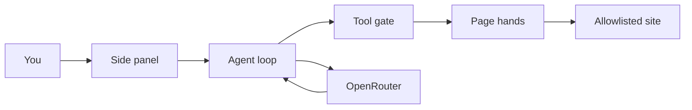
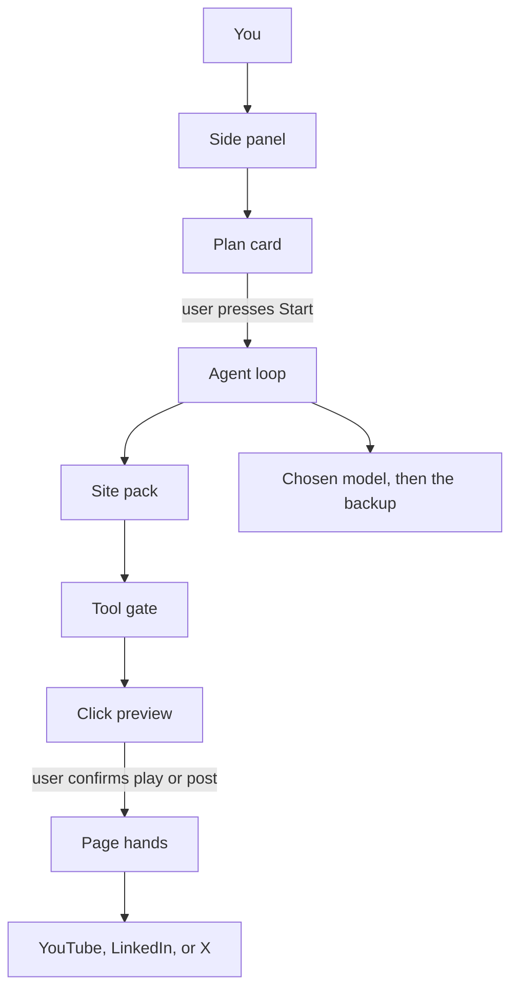

# Jeco Agent V2

Local Brave extension. No hosted copy of the user's browsing. V2 makes two jobs repeatable: play a YouTube video, and draft a LinkedIn or X post that waits for the user.

V1 already ships and works: side panel, agent loop, tool gate, page hands, OpenRouter (default `google/gemma-4-26b-a4b-it:free`), site allowlist, confirm-before-post, Pause refused, 12-step cap. Load the built extension from `dist/` via `brave://extensions` → Load unpacked.

## What ships

**A plan before the first click.** The model returns three lines of what it intends to do. The panel shows them with Start and Cancel. Nothing opens until the user presses Start.

**A picture of the click that matters.** Before Play, and before Post, the panel shows the button it is about to use and the text it will type. Play it and Post it are the only ways those clicks happen. Pause stays refused.

**Two site packs.** Fixed steps, so the model is not guessing the search box every time.

- YouTube: open the site, search, open the video, click Play if it is paused.
- LinkedIn and X: open the composer, type the draft, then stop on the confirm card. The post goes out only after Post it.

**Saved tasks.** A finished task can be kept under a name, such as "David Laid video". Store it in the extension, next to the key and the site list. Running it again shows the plan first.

**A backup model.** Settings keep the free model, plus an optional second model on the same OpenRouter key. If the free one is busy, that step tries the backup before it gives up.

**A local model switch.** An optional base URL, empty by default. Point it at a local OpenAI-compatible server and the page text stays on the Mac. Leave it empty and Jeco keeps using OpenRouter.

## What stays out

- No cloud copy of browsing.
- No store of extra site packs.
- No schedules. A saved task runs only when the user presses it.
- The gate, the allowlist, and the 12-step cap stay as they are.

## Build order

1. Plan card, then the click preview.
2. YouTube pack, then the LinkedIn and X draft pack.
3. Saved tasks.
4. Backup model and the local base URL.

## How V1 fits together

There is no separate server. The side panel is the screen and also runs the loop.

Gemma never touches Brave. Each step it returns one tool: `open_tab`, `navigate`, `read_page`, `click`, `type`, `scroll`, `ask_to_post`, or `finish`. The gate allows or blocks that order. Page hands is injected into the tab for that one action, then discarded. A read becomes a numbered list of controls. The result goes back to the model.

Main files:

- `src/sidepanel/panel.ts`, `panel.css`, `index.html` — chat, settings, steps, confirm
- `src/loop.ts` — the step loop and the system prompt
- `src/gate.ts` — allowlist, Pause refusal, publish confirm
- `src/page-hands.ts` — read, click, type, scroll, commit a post
- `src/browser.ts` — tabs and script injection
- `src/openrouter.ts` — model client; already tries other free models when one is busy
- `src/storage.ts`, `src/types.ts` — key, model, sites in `chrome.storage.local`
- `src/background.ts` — opens the side panel only

Rebuild with `npm run build` from this folder, then reload the extension on `brave://extensions`.

## V2 shape

When implementing, follow the build order above. Do not add schedules, a pack store, or a cloud backend.
