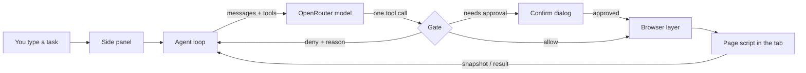

# Jeco Agent

Jeco is an AI browser agent that lives in Brave's side panel. You type a task in plain English ("find a lo-fi playlist on YouTube and play it", "draft a reply to this thread"), and Jeco reads the page, clicks, types, scrolls, and navigates for you, one step at a time.

It runs entirely as a local extension. There is no backend server: the extension talks straight to [OpenRouter](https://openrouter.ai) for the model, and your API key never leaves the extension's local storage.

Safety comes first. Jeco can only act on sites you add to an allowlist, it can never type into password or payment fields, and it will never publish anything (post, tweet, reply, send, submit) without you approving the exact text first.

---

## Features

- **Side panel agent.** Click the Jeco icon to open a panel next to any tab. Type a task, press Run, and watch each step appear live. Press Stop at any time.
- **Per-site allowlist.** Jeco only opens, reads, or acts on sites you've added, and each site has two toggles:
  - **Interact** (on by default): allow clicking and typing. With it off, Jeco can only open, read, and scroll.
  - **Post** (off by default): allow publishing, always behind a confirmation.
- **Confirm-before-publish.** Any click on a control named Post, Tweet, Reply, Repost, Send, Submit, or Publish is paused and shown to you first. Nothing goes out until you press "Post it".
- **Hard blocks.** Password and payment fields are detected and refused, both in the decision layer and inside the page script.
- **Redirect protection.** If a click or navigation lands outside the allowlist, Jeco closes the tab or goes back automatically.
- **Step cap.** Each task is limited to 12 steps, so a confused model can't loop forever.
- **Bring your own model.** Uses any OpenRouter model with tool calling. It defaults to a free model, and if that request fails it automatically tries a few other free models.

---

## How it works



1. **Agent loop** (`src/loop.ts`) sends the conversation to the model and expects exactly one tool call back. Extra calls are ignored ("one action at a time").
2. **Gate** (`src/gate.ts`) is a pure function that checks every call against the allowlist, the current page, the site's permission level, and the list of known controls. It returns one of four outcomes: allow, deny (with a reason the model can read), confirm (ask the user), or finish.
3. **Browser layer** (`src/browser.ts`) wraps Chrome's `tabs` and `scripting` APIs to open tabs, navigate, wait for loads (15 s timeout), and run commands in the page.
4. **Page script** (`src/page-hands.ts`) is injected into the tab. It builds a snapshot of the page (title, visible text up to 6,000 characters, and up to 80 numbered controls), and performs clicks, typing, and scrolling by control number.
5. **Snapshot formatter** (`src/snapshot.ts`) turns that page snapshot into compact text for the model.

### Tools the model can call

| Tool | What it does |
| --- | --- |
| `open_tab` | Open an https URL in a new tab (must be allowlisted). |
| `navigate` | Go to an https URL in the current tab (must be allowlisted). |
| `read_page` | Return the page title, visible text, and numbered controls. |
| `click` | Click a numbered control from the latest `read_page`. |
| `type` | Type text into a numbered text field (max 4,000 characters). |
| `scroll` | Scroll vertically by up to ±2,000 px. |
| `ask_to_post` | Propose exact text to publish; always requires your approval. |
| `finish` | End the task with a short answer for you. |

---

## Project structure

```
jeco-agent/
├── src/
│   ├── background.ts       # Service worker: opens the side panel on icon click
│   ├── browser.ts          # Tab/navigation/scripting wrapper
│   ├── gate.ts             # Allowlist + safety decisions (pure, unit-tested)
│   ├── loop.ts             # The agent loop and system prompt
│   ├── openrouter.ts       # OpenRouter client and tool definitions
│   ├── page-hands.ts       # Script injected into pages: read, click, type, scroll
│   ├── snapshot.ts         # Formats page snapshots for the model
│   ├── storage.ts          # Settings in chrome.storage.local
│   ├── types.ts            # Shared types and limits
│   ├── manifest.json       # Manifest V3
│   └── sidepanel/          # Panel UI (HTML, CSS, TS)
├── tests/                  # gate, loop, and snapshot tests
├── esbuild.mjs             # Build script, outputs to dist/
├── package.json
└── tsconfig.json
```

---

## Getting started

### Requirements

- [Brave](https://brave.com) (or any Chromium browser that supports the Side Panel API, Chrome 114+)
- Node.js 20 or newer
- An [OpenRouter API key](https://openrouter.ai/keys) (free models work)

### Install and build

```bash
git clone https://github.com/JaiCodes77/Jeco-Agent.git
cd Jeco-Agent
npm install
npm test          # run the unit tests
npm run build     # bundles into dist/
```

### Load the extension

1. Open `brave://extensions`.
2. Turn on **Developer mode** (top right).
3. Click **Load unpacked** and choose the `dist` folder.
4. Pin the Jeco icon and click it to open the side panel.

### First-time setup

1. Click **Settings** in the panel.
2. Paste your OpenRouter key and press **Save key**. Optionally change the model (default `google/gemma-4-26b-a4b-it:free`).
3. Add a site, for example `youtube.com`. Brave will ask you to grant access to that site.
4. The site is added with **Interact** on and **Post** off. Flip either toggle as needed. Removing a site also revokes Brave's access to it.
5. Close Settings, type a task, and press **Run**.

---

## Example tasks

- "Open youtube.com, search for lofi hip hop, and play the first live stream."
- "Read this page and summarize the main points."
- "On x.com, draft a reply saying congrats on the launch." (You'll see the exact text and must approve it.)

---

## Privacy

- Your OpenRouter key is stored only in the extension's local storage (`chrome.storage.local`) and sent only to `openrouter.ai`.
- On each step, the page's visible text and control labels are sent to OpenRouter so the model can pick the next action. Passwords, cookies, and payment details are never read or sent.
- The extension only requests host access for sites you add. Nothing runs on other sites.

---

## Development

| Command | Purpose |
| --- | --- |
| `npm run build` | Bundle `src/` into `dist/` with esbuild (Chrome 120 target). |
| `npm test` | Run the Node test runner on `tests/*.test.ts` via `tsx`. |
| `npm run typecheck` | Strict TypeScript check with no emit. |

After changing code, rebuild and press the reload icon on the extension card in `brave://extensions`.

### Key limits (in `src/types.ts`)

| Constant | Value | Meaning |
| --- | --- | --- |
| `STEP_CAP` | 12 | Max steps per task |
| `TEXT_CAP` | 6000 | Max page text sent per read |
| `CONTROL_CAP` | 80 | Max numbered controls per read |

---

## License

No license has been chosen yet. All rights reserved by the author until one is added.
